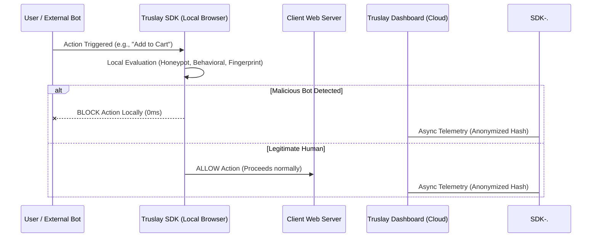
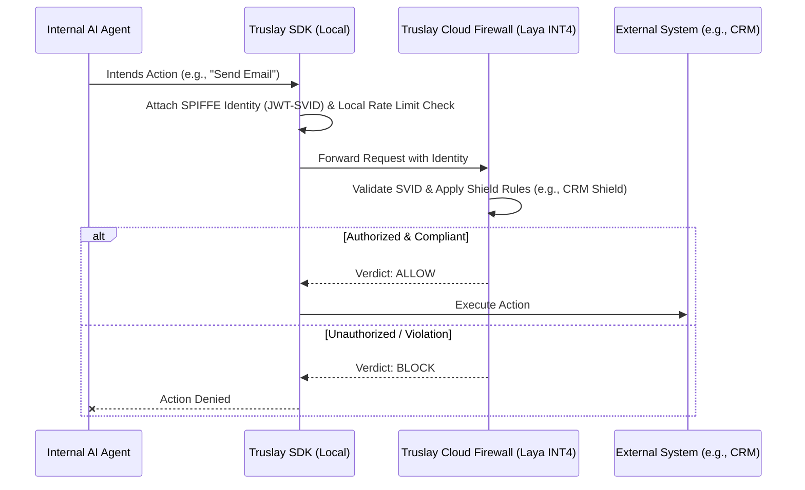
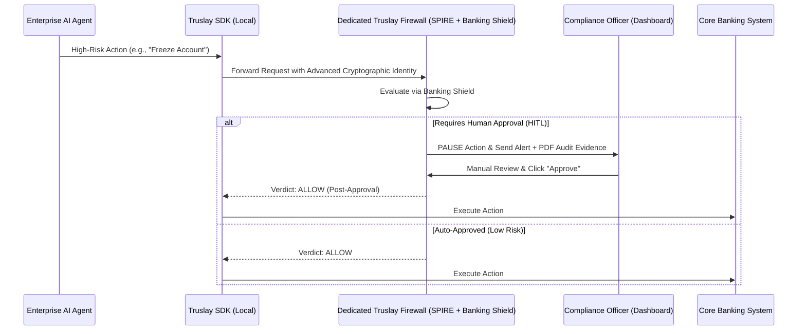

## 🔄 System Interaction Scenarios

Truslay dynamically adapts its architecture based on your needs. Below are the visual workflows of how our SDK and Cloud Firewall interact across our three primary deployment modes.

### 🟢 Scenario 1: Defense Mode (Companies WITHOUT AI Agents)

*Zero-latency, 100% local evaluation. The Firewall only receives anonymized telemetry for the dashboard.*

### 🔵 Scenario 2: Collaboration Mode (Companies WITH AI Agents)

*The SDK attaches a cryptographic workload identity and defers the decision to the Cloud Firewall.*

### 🟣 Scenario 3: High-Risk Collaboration (Human-in-the-Loop)

*Critical actions in regulated industries pause for human approval with auditable evidence.*

## Which mode do I need?

| Your situation | Mode | Network requirement |
| --- | --- | --- |
| You want to stop external bots and scrapers on your own site | Defense | None — 100% local |
| You run AI agents that act on third-party systems | Collaboration | Cloud Firewall + JWT-SVID |
| You need human approval for high-risk agent actions | Collaboration (HITL) | Cloud Firewall + SPIRE + Dashboard |

Defense and Collaboration are independent products: you can ship Defense today
and enable Collaboration later without changing how your site works.
